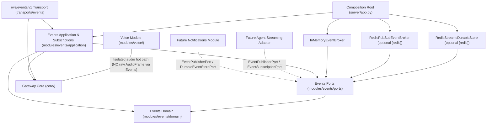

# Kaiwen Gateway — Events Module Design Specification (`D0` Proposed Baseline)

> **Status:** `Proposed` (`D0` Architecture & Documentation Baseline — **NOT YET IMPLEMENTED**)
> **Baseline Reference:** `kaiwen-gateway v0.1.0b1` (`main` `91ee612fdfc179b94945ec9cde332748de57ea56`; **Voice** is the only implemented communication module)
> **Related ADR:** [ADR-0006 — Events Module Architecture (`Proposed`)](decisions/0006-events-module-architecture.md)
> **Related Docs:** [Architecture](ARCHITECTURE.md) · [Requirements](REQUIREMENTS.md) · [Roadmap](../ROADMAP.md) · [Public API Policy](PUBLIC_API_AND_COMPATIBILITY.md)

---

## 1. Goals and Non-Goals

### 1.1 Goals
1. Provide a reusable, provider-neutral **Events** module (`src/kaiwen_gateway/modules/events/`) inside the existing `kaiwen-gateway` modular monolith (`ADR-0001`).
2. Support real-time application event publishing, multi-tenant Pub/Sub fan-out, and authenticated WebSocket delivery (`/ws/events/v1`).
3. Enforce strict multi-tenant isolation, server-derived principal identity, channel access controls, configurable token-bucket rate limiting, and bounded per-subscriber backpressure.
4. Support zero-dependency in-process operation (`InMemoryEventBroker`) by default, plus optional distributed live fan-out (`RedisPubSubEventBroker`), optional durable stream processing (`RedisStreamsDurableStore`), and optional distributed rate limiting behind a future `kaiwen-gateway[redis]` extra.
5. Expose clean, stable contracts that future **Notifications** and **Agent Streaming** modules can consume without duplicating broker or transport logic.

### 1.2 Non-Goals (and D0 Boundaries)
- **No implementation during D0:** No Python source files, dependencies, Dockerfiles, or CI changes are introduced in D0.
- **No Voice audio hot-path routing:** Canonical 16 kHz PCM16LE `AudioFrame`s (`VoiceBridgeSession`) must **never** be routed through Events.
- **No universal Event Bus in `kaiwen_gateway.core`:** Core owns lifecycle, identity, admission, and shared contracts—not topic routing or pub/sub brokers.
- **No global ordering or exactly-once claims:** Live Pub/Sub is `at-most-once` with per-publisher/per-channel best-effort ordering; durable Redis Streams is `at-least-once` with idempotent consumer design.
- **No Notifications or Agent Streaming implementation:** Only consumption boundaries are defined.

---

## 2. Architecture, Packaging & Component Ownership

### 2.1 Packaging & Module Layout
Events lives inside the single `kaiwen-gateway` PyPI distribution:

```text
src/kaiwen_gateway/
├── core/                         # Zero-dep Core (registration, lifecycle, identity, admission)
├── modules/
│   ├── voice/                    # Implemented in v0.1.0b1 (isolated PCM16LE media hot path)
│   └── events/                   # Proposed (E1–E4):
│       ├── domain/               # EventEnvelope, Topic, EventError, limits, validation
│       ├── ports/                # EventPublisherPort, EventSubscriptionPort, DurableEventStorePort, RateLimiterPort, EventsTelemetrySink
│       ├── application/          # EventsModule (GatewayModule), EventsDispatcher, SubscriptionManager, TokenBucketRateLimiter
│       └── adapters/             # InMemoryEventBroker, RedisPubSubEventBroker (optional), RedisStreamsDurableStore (optional)
├── transports/
│   ├── synthetic/                # Implemented synthetic telephony/media transports
│   └── events/                   # Proposed (E2): /ws/events/v1 ASGI/WSS endpoint & frame codec
└── server/                       # Composition root (app.py, lifespan.py)
```

Optional dependencies (`redis>=5,<6` or similar) will be gated behind `kaiwen-gateway[redis]` in a future `E3` milestone. Importing `kaiwen_gateway`, `kaiwen_gateway.core`, or `kaiwen_gateway.modules.voice` must never require or import `redis`.

### 2.2 Dependency Diagram



### 2.3 Ownership Matrix

| Layer | Owns | Must Not Own |
| --- | --- | --- |
| **Gateway Core (`core/`)** | `GatewayModule` registration (`ModuleRegistry`), `ModuleLifecycleManager`, `AdmissionController`, `ConnectionSupervisor`, `InstanceDrainCoordinator`, trusted identity primitives | Topic routing, JSON event envelopes, Pub/Sub brokers, Redis clients, WebSocket frame parsing |
| **Events Module (`modules/events/`)** | `EventEnvelope`, topic validation, `EventPublisherPort` / `EventSubscriptionPort` / `DurableEventStorePort`, subscriber registry, per-subscriber bounded queues, token-bucket rate limiting, `EventsTelemetrySink` | ASGI/Starlette WebSocket objects, raw HTTP headers, Voice PCM audio frames, notification templates, agent reasoning |
| **Events Transport (`transports/events/`)** | `/ws/events/v1` handshake, pre-upgrade/post-connect auth invocation, JSON frame size checks, command dispatch (`subscribe`, `unsubscribe`, `ping`), close codes | Direct Redis access, cross-tenant routing, trusted identity fabrication from client JSON |
| **Composition Root (`server/`)** | Concrete broker/store instantiation, Redis client lifecycle, `core.register_module(events_module)`, `gateway_lifespan` wiring | Business authorization rules or hidden global broker singletons |
| **Future Notifications / Agent Streaming** | Domain templates, delivery channels (email/push/webhook), LLM token/tool streaming logic | Re-implementing Pub/Sub fan-out, WebSocket subscription registries, or Redis Streams consumer plumbing |

---

## 3. Broker & Durable Store Abstractions (`modules/events/ports/`)

To avoid redundant interfaces while keeping live fan-out distinct from durable stream storage, the proposed port contracts are:

1. **`EventPublisherPort` (Live Fan-Out Write Side):**
   - `async def publish(self, event: EventEnvelope) -> PublishResult`
   - Publishes an immutable, already-authorized `EventEnvelope` to live subscribers matching `(event.tenant_id, event.topic)`.
   - Returns `PublishResult(accepted: bool, delivered_local_count: int, dropped_slow_subscribers: int)` without blocking on slow consumers.
2. **`EventSubscriptionPort` (Live Fan-Out Read Side):**
   - `async def subscribe(self, *, tenant_id: str, subscriber_id: str, topic_pattern: str, queue_capacity: int) -> EventSubscription`
   - `async def unsubscribe(self, *, tenant_id: str, subscriber_id: str, topic_pattern: str | None = None) -> None`
   - Returns an `EventSubscription` handle exposing `async def receive(self) -> EventEnvelope | None` (bounded `asyncio.Queue` backed) and `async def close() -> None`.
3. **`EventBrokerPort` (Unified Live Broker Protocol):**
   - Structural `Protocol` combining `EventPublisherPort` and `EventSubscriptionPort` plus `async def startup() -> None` and `async def shutdown() -> None` (satisfied by `InMemoryEventBroker` and `RedisPubSubEventBroker`).
4. **`DurableEventStorePort` (Optional Append-Only Log & Replay):**
   - `async def append(self, event: EventEnvelope) -> str` (returns stream entry ID).
   - `async def read_group(self, *, tenant_id: str, topic: str, group: str, consumer: str, count: int, block_ms: int) -> list[DurableEventRecord]`
   - `async def ack(self, *, tenant_id: str, topic: str, group: str, record_ids: Sequence[str]) -> int`
   - `async def replay(self, *, tenant_id: str, topic: str, from_id: str = "0-0", limit: int = 100) -> list[DurableEventRecord]`

### 3.1 Delivery & Ordering Semantics Comparison

| Backend / Port | Purpose | Delivery Guarantee | Ordering Guarantee | Offline Replay |
| --- | --- | --- | --- | --- |
| `InMemoryEventBroker` | Single-process live fan-out | **At-most-once** | Per-publisher FIFO within a single topic | None |
| `RedisPubSubEventBroker` | Multi-instance live fan-out | **At-most-once** | Per-publisher FIFO on a single Redis channel; no cross-instance global order | None |
| `RedisStreamsDurableStore` | Durable event log & worker groups | **Intended at-least-once** (with explicit `XACK` + PEL recovery; subject to `MAXLEN` eviction and non-atomic ACK/crash windows) | Total order within a single Redis Stream key `(tenant_id, topic)` | Bounded by `MAXLEN` retention |

---

## 4. Event Envelope & `/ws/events/v1` Protocol

### 4.1 Canonical `EventEnvelope` (JSON Schema)

```json
{
  "protocol_version": "v1",
  "event_id": "evt_01JCH9W8K2M3N4P5Q6R7S8T9VW",
  "event_type": "agent.turn.completed",
  "topic": "agent.session.sess_42",
  "timestamp": "2026-11-17T20:00:00.123456Z",
  "tenant_id": "tenant_alpha",
  "principal_id": "svc_kaiwen_agent",
  "correlation_id": "corr_9f8e7d6c",
  "payload": {
    "session_id": "sess_42",
    "status": "completed"
  }
}
```

- **Canonical `event_type` naming:** Lowercase dot-separated ASCII slug `^[a-z][a-z0-9_]*(\.[a-z][a-z0-9_]*){1,4}$` (max 96 chars, e.g. `voice.call.ended`, `notifications.alert.created`).
- **Topic naming & validation:** `^[a-z0-9][a-z0-9._-]{0,127}$` (wildcard subscriptions, if explicitly authorized by scope, use trailing `.*` only; bare `*` is forbidden for public clients). Internal routing keys are **always** prefixed by server-verified `tenant_id` (e.g., `kw:evt:v1:{tenant_id}:{topic}`).
- **Serialization & Size Limits:** UTF-8 JSON only (`allow_nan=False`), max serialized frame size `65,536` bytes (`64 KiB`, provisional), max JSON nesting depth `16`.
- **Schema Compatibility:** Additive optional fields allowed within `"v1"`; breaking envelope changes require `"v2"` (`/ws/events/v2`).
- **Unknown Version / Malformed / Oversized Handling:**
  - Unknown `protocol_version` -> error frame `{"type": "error", "code": "UNSUPPORTED_VERSION", ...}` and close `1008` (or reject command).
  - Malformed JSON / invalid schema -> error frame `{"type": "error", "code": "INVALID_FRAME", ...}` and close `1007`.
  - Oversized frame (`> 65,536` bytes) -> close `1009` (`Message Too Big`) before full JSON parsing.
- **Duplicate Event Handling:** `event_id` is globally unique per published event (UUIDv7/ULID). At-least-once durable consumers must deduplicate by `event_id` within their domain handler.

### 4.2 `/ws/events/v1` Wire Messages (Client Commands vs. Server Events)

Client-to-server frames (`command` / `type` namespace) are strictly separated from server-to-client event deliveries:

| Direction | `type` | Required Fields | Behavior |
| --- | --- | --- | --- |
| **Server -> Client** | `session.ready` | `protocol_version`, `connection_id`, `tenant_id`, `principal_id`, `allowed_scopes` | Sent immediately after authenticated upgrade. |
| **Client -> Server** | `events.subscribe` | `request_id`, `topic` | Checks scope & subscription quota; binds to verified `tenant_id`; replies `events.subscribed` or `error`. |
| **Client -> Server** | `events.unsubscribe` | `request_id`, `topic` | Removes subscription and cleans queue state; replies `events.unsubscribed`. |
| **Client -> Server** | `session.ping` | `seq` (optional) | Replies `session.pong` (`seq` echoed). |
| **Server -> Client** | `events.delivery` | `request_id` (optional), `event` (`EventEnvelope`) | Delivers matching tenant-scoped event from subscriber queue. |
| **Server -> Client** | `events.error` | `request_id` (optional), `code`, `message` | Sanitized diagnostic error (no secrets, stack traces, or cross-tenant details). |
| **Client -> Server** | `events.publish` | *(Disabled for public clients by default)* | Rejected with `FORBIDDEN_PUBLISH` (`1008`) unless explicitly enabled for a trusted scope (`events:publish:<topic>`). |

---

## 5. Security Model, Fail-Closed Ingress & Core Identity Integration (R1 & R5)

### 5.1 Fail-Closed Events Ingress Configuration (R5)
Enabling `/ws/events/v1` must never bypass Core ingress or authentication policies:

1. **No Standalone `enable_events=True` Bypass:** Passing `enable_events=True` to `create_gateway_app(...)` when `CoreConfig.ingress_mode == "disabled"` **MUST** fail closed (either refusing to mount `/ws/events/v1` or raising `CoreConfigurationError` at app construction time).
2. **Mandatory Authenticator / Authorizer Before Mount:** When Events WebSocket ingress is enabled (via an explicit authenticated Events ingress mode or `ingress_mode="synthetic"` / dedicated `events_auth_bridge` in `E2`), `create_gateway_app(...)` **MUST** require an explicit, non-None authenticator/verifier with replay protection enabled (or equivalent verified server-side credential verifier) and fail closed with `CoreConfigurationError` if missing.
3. **Fail-Closed Defaults:** `CoreConfig.ingress_mode` remains `"disabled"` by default; Events WebSocket ingress defaults to `enable_events=False`.

### 5.2 Fail-Closed Trust Boundaries & Authorization (R5)
1. **Authentication Before Privileged Operations:** `/ws/events/v1` authenticates bearer credentials (`Authorization: Bearer <token>`) **before** WebSocket `accept()` (rejecting invalid/missing/expired/replayed tokens pre-accept with HTTP `403` or `1008` without allocating subscriber queues or `AdmissionLease`s).
2. **Server-Derived Tenant & Principal:** `tenant_id` and `principal_id` come **exclusively** from the verified server token/authenticator. Any `tenant_id` or `principal_id` inside a client JSON payload is ignored or rejected on mismatch (`1008`).
3. **Subscription Authorization:** Every `events.subscribe` command checks the connection's immutable `allowed_scopes` (e.g., `events.subscribe` or scoped `events.subscribe.<topic_prefix>`) against `(verified_tenant_id, requested_topic)`. Wildcard patterns (`topic.*`) require an explicit wildcard scope (`events.subscribe.wildcard` or explicit prefix grant) and are denied by default (`events.error` `FORBIDDEN_SUBSCRIPTION`, or `1008` on policy abuse). Bare `*` is always rejected for public clients.
4. **Server-Side Publish Authorization:** Public WebSocket clients cannot publish arbitrary events merely by holding an active connection; `events.publish` over `/ws/events/v1` is **disabled by default** and fails closed (`events.error` `FORBIDDEN_PUBLISH` / close `1008`). Trusted server-side publishers (Voice lifecycle hooks, Notifications, Agent Streaming) publish in-process via `EventPublisherPort` using server-verified `tenant_id` and `principal_id`.
5. **Redaction & Resource Exhaustion Resistance:** Payloads are size-capped (`64 KiB` provisional), depth-capped (`16`), and never logged verbatim by default (`SEC-006`). Error responses use fixed sanitized codes.

### 5.3 Audit of Existing Core Identity & Backward-Compatible Integration (R1)
- **Constraint Discovered in `core/`:**
  - [`TenantCallBinding`](../src/kaiwen_gateway/core/identity.py#L400) and [`VerifiedConnectionContext`](../src/kaiwen_gateway/core/identity.py#L436) require a non-empty `call_id` (`validate_call_id`).
  - [`AdmissionController.acquire(context)`](../src/kaiwen_gateway/core/admission.py#L170), [`AdmissionLease`](../src/kaiwen_gateway/core/admission.py#L63), and [`ConnectionSupervisor(context=..., controller=...)`](../src/kaiwen_gateway/core/lifecycle.py#L270) all type-check and store `VerifiedConnectionContext` (`tenant_id`, `connection_id`, `allowed_scopes`, `require_scope()`, `has_scope()`).
  - Consequently, defining `VerifiedPrincipalContext` alone without integrating `AdmissionController`, `AdmissionLease`, and `ConnectionSupervisor` would either fail runtime/type checks or force Events to bypass Core admission and draining.
- **Preferred Additive Solution (for `E1`/`E2`, zero changes in `D0`):**
  1. **Keep `TenantCallBinding` & `VerifiedConnectionContext` intact for Voice:** `call_id` remains mandatory on `TenantCallBinding` and `VerifiedConnectionContext`; no Voice invariant is weakened and no fake `call_id` (e.g., `"events-none"`) is ever fabricated.
  2. **Add `TenantPrincipalBinding` & `VerifiedPrincipalContext` in `kaiwen_gateway.core.identity`:** Frozen dataclasses carrying `connection_id`, `provider_id`, `tenant_id`, `principal_id`, `allowed_scopes: frozenset[str]`, plus `has_scope()` / `require_scope()` / `require_tenant_and_principal()`.
  3. **Define a Narrow Structural Protocol `VerifiedConnectionIdentity` (or `AdmissibleContext`) in `kaiwen_gateway.core.identity`:**
     - Exposes `connection_id: str`, `tenant_id: str`, `provider_id: str`, `allowed_scopes: frozenset[str]`, `has_scope(scope: str) -> bool`, `require_scope(scope: str) -> None`.
     - Satisfied by **both** `VerifiedConnectionContext` (Voice, retaining `call_id`) and `VerifiedPrincipalContext` (Events, carrying `principal_id` without `call_id`).
  4. **Update `AdmissionController`, `AdmissionLease`, and `ConnectionSupervisor` Type Acceptance (Backward-Compatible):**
     - Accept `VerifiedConnectionContext | VerifiedPrincipalContext` (via explicit `isinstance` check against the closed two-type union rather than arbitrary duck typing, preserving Core's fail-closed forge resistance).
     - Expose `AdmissionLease.call_id: str | None` (`None` for principal leases, non-empty `str` for call leases) or a typed accessor without breaking Voice callers.
     - `AdmissionController` continues to enforce global and per-tenant ceilings (`tenant_id`), deduplicate `connection_id`, and prune zero-count tenants identically for both Voice and Events.
     - `ConnectionSupervisor` and `InstanceDrainCoordinator` supervise Events WebSocket connections with the exact same `ConnectionState` machine, `AdmissionLease` ownership, and `DrainReport` guarantees as Voice.
- **Alternatives Considered & Rejected:**
  - *Make `call_id: str | None = None` on `VerifiedConnectionContext`:* Rejected because Voice callers and `VoiceBridgeSession` rely on `context.call_id: str` always being non-empty; making it optional weakens static and runtime Voice invariants.
  - *Duplicate a separate `EventsAdmissionController` and `EventsConnectionSupervisor` inside `modules/events/`:* Rejected because it would split global `max_concurrent_connections` / `max_connections_per_tenant` accounting and bypass `InstanceDrainCoordinator` during ASGI shutdown.

---

## 6. Rate Limiting, Aggregate Memory Bounds & Backpressure (R2 & R5)

### 6.1 Provisional Limits & Distinction from `AdmissionController`
`AdmissionController` enforces **concurrent connection leases** (`max_concurrent_connections`, `max_connections_per_tenant`). It does **not** enforce per-second message/publish rates or queued payload memory. Events adds explicit rate, queue-count, and **byte-level memory bounds** (**all numerical defaults below are provisional until `E4` benchmark qualification**):

| Control Dimension | Scope | Provisional Default | Rejection / Overflow Behavior |
| --- | --- | --- | --- |
| Concurrent Connections | Global / Tenant (`AdmissionController`) | Inherited from `CoreConfig` (`25` / `10`) | Reject handshake pre-accept (`403` / `1008`) |
| Client Control Message Rate | Per-connection token bucket | `20 msg/s`, burst `40` | `events.error` (`RATE_LIMITED`); close `1008` (`Policy Violation`) on repeated abuse |
| Publish Rate | Per-tenant / Per-principal token bucket | `200 evt/s`, burst `400` | Reject `publish()` with `EventRateLimitError` (increment `rate_limit_rejections_total`) |
| Subscription Operations | Per-connection token bucket | `10 ops/s`, burst `20` | `events.error` (`RATE_LIMITED`) |
| Max Subscriptions per Connection | Per-connection | `32` | `events.error` (`SUBSCRIPTION_LIMIT_EXCEEDED`) |
| Max Payload / Frame Size | Per-frame | `65,536` bytes (`64 KiB`) | Close `1009` (`Message Too Big`) |
| Outbound Queue Architecture | **One bounded queue per connection** (multiplexed across all active subscriptions on that connection) | `128` events max **AND** `1,048,576` bytes (`1 MiB`) max per connection | **Never per-subscription unbounded multiplication**; triggers slow-consumer overflow policy |
| Global Queued-Byte Budget | Process-wide across all Events connections | `33,554,432` bytes (`32 MiB`) | Reject/drop new enqueue (`OVERLOAD_MEMORY_BUDGET`), increment `events_dropped_total`; never OOM |
| Idle Timeout | Per-connection | `60.0 s` without ping/activity | Server closes `1000` (`Idle timeout`) |

### 6.2 Aggregate Memory Accounting & Why One Queue Per Connection (R2)
Counting events alone is unsafe: `32` subscriptions × `128` events × `64 KiB` = `256 MiB` per single connection (`6.4 GiB` at `25` connections). To prevent memory exhaustion:

1. **Single Multiplexed Queue Per Connection:** Each WebSocket subscriber connection owns **one** outbound queue shared across all of its active topic subscriptions (capped at `32` topics), eliminating the `N_subscriptions × queue_capacity` multiplier.
2. **Dual Count + Byte Accounting:** Every enqueued `EventEnvelope` tracks its serialized byte size (`event_size_bytes`). Enqueueing checks **both** `len(conn_queue) < max_events_per_conn (128)` **and** `conn_queued_bytes + event_size_bytes <= max_bytes_per_conn (1 MiB)` **and** `global_queued_bytes + event_size_bytes <= max_global_queued_bytes (32 MiB)`.
3. **Deterministic Release on Dequeue / Close:** Dequeuing, dropping, or closing a connection decrements `conn_queued_bytes` and `global_queued_bytes` atomically inside `finally` / cleanup paths so counters never leak.
4. **Memory-Bound Acceptance Tests (`E1`/`E2`):** Tests must inject worst-case `64 KiB` events across `32` subscriptions and verify per-connection bytes stay `<= 1 MiB`, global bytes stay `<= 32 MiB`, and all byte counters return to `0` on disconnect.

### 6.3 Process-Local vs. Distributed Rate Limiting
- **Process-local (`E1`/`E2`):** In-memory token bucket (`TokenBucketRateLimiter`) with zero external dependencies. Applies per worker process.
- **Distributed (`E3`, optional `[redis]`):** Lua/atomic token-bucket or sliding-window counters in Redis keyed by `kw:rl:v1:{tenant_id}:{dimension}`. Redis does **not** automatically enforce limits without explicit adapter wiring; if Redis is unavailable, tenant-facing privileged operations fail closed (or fall back to stricter local caps only when explicitly configured).

### 6.4 Backpressure, Slow-Consumer Default Policy & WebSocket Close Codes (R5)
- **Slow-Consumer Isolation:** Broker `publish()` enqueues into each matching connection's bounded outbound queue via non-blocking `put_nowait()`. One slow subscriber never blocks `publish()` or stalls other subscribers/tenants.
- **Default Slow-Consumer Policy (`disconnect_slow_consumer`):** When a connection's outbound queue exceeds `max_events_per_conn` or `max_bytes_per_conn`, the server drops the overflow event, increments `events_dropped_total`, and closes the slow WebSocket with close code `1008` (`Slow consumer overflow`). An optional `drop_oldest` mode may be explicitly opted into for non-critical telemetry streams, but **never** silently buffers unboundedly.
- **Canonical `/ws/events/v1` Close Codes:**
  - `1000` (`Normal Closure`): Client `session.end` or idle timeout.
  - `1007` (`Invalid Frame Payload Data`): Malformed JSON or invalid UTF-8/schema.
  - `1008` (`Policy Violation`): Missing/invalid/replayed auth (post-accept), forged `tenant_id`, unauthorized wildcard/publish, repeated rate-limit abuse, or slow-consumer overflow.
  - `1009` (`Message Too Big`): Frame exceeding `65,536` bytes.
  - `1011` (`Internal Error`): Unrecoverable internal or Redis backend failure.
- **Module Lifecycle:** `EventsModule` implements `GatewayModule` (`module_id="events"`, `contract_version="1.0"`). `ModuleLifecycleManager` starts the broker on ASGI startup and drains/closes active subscriptions and Redis pools on shutdown before `gateway_lifespan` exits.

---

## 7. Optional Redis Architecture (`kaiwen-gateway[redis]`) (R3 & R4)

1. **Redis Pub/Sub (`RedisPubSubEventBroker` — Milestone `E3`):**
   - Cross-instance live fan-out on `kw:evt:v1:{tenant_id}:{topic}` plus distributed rate limiting and shared Redis connection lifecycle.
   - **At-most-once**, no offline replay. Dedicated background listener task with bounded exponential-backoff reconnect (`100 ms` -> `5 s` cap) and health status reporting.
2. **Redis Streams (`RedisStreamsDurableStore` — Milestone `E4`):**
   - Append-only durable log (`XADD` with `MAXLEN ~ 10000` provisional retention cap) + consumer groups (`XREADGROUP` / `XACK`).
   - **Pending-Entry Recovery (`XPENDING` / `XAUTOCLAIM`):** Consumers that crash after `XREADGROUP` leave entries in the group's Pending Entries List (PEL). A bounded recovery loop periodically inspects `XPENDING` and reclaims entries idle beyond `claim_min_idle_ms` (provisional `30,000 ms`) via `XAUTOCLAIM` up to `max_delivery_attempts` (provisional `5`) before routing poison entries to a dead-letter stream or quarantine log.
   - **Acknowledgment Ownership:** `XACK` is issued **only** by the owning consumer worker **after** downstream processing succeeds; transport queues must never `XACK` on enqueue.
   - **Retention & Trimming Interactions:** Approximate `MAXLEN ~` trimming can evict unacknowledged entries if a consumer group lags beyond the retention window, turning delivery into loss for that lagged group.
   - **Intended vs. Actually Guaranteed Behavior (R3):**
     - *Intended:* **At-least-once** delivery within the retention window.
     - *Actually Guaranteed:* **At-least-once only while entries remain within `MAXLEN` and Redis persists the stream**; crashes between downstream side-effect execution and `XACK` cause **redelivery** (requiring idempotent consumers keyed by `event_id`), and Redis failover without `WAIT`/AOF `always` can lose recently acknowledged or un-replicated writes. Redis Streams **never** provides exactly-once processing and **never** replaces per-WebSocket bounded memory queues.
3. **Unavailability & Degraded Mode:**
   - Core and in-memory Events work with zero Redis dependency.
   - When Redis is configured and becomes unreachable: `publish()` / `append()` raise `EventsBackendUnavailableError` (fail closed for durable writes; live WebSocket clients receive sanitized `BACKEND_UNAVAILABLE` and `1011` close if unrecoverable).

---

## 8. Observability (`EventsTelemetrySink`)

Auditing `src/kaiwen_gateway/` confirms that only `modules/voice/telemetry.py` exists today (`VoiceTelemetrySink`, `InMemoryVoiceTelemetrySink`); Gateway Core does **not** yet provide a general-purpose structured logger or shared metric registry.

- **D0/E1 Design:** Mirror Voice's clean sink pattern with `EventsTelemetrySink` and `InMemoryEventsTelemetrySink` inside `modules/events/ports/` & `telemetry.py`:
  - **Metrics:** `active_connections`, `active_subscriptions`, `events_published_total`, `events_delivered_total`, `events_dropped_total` (overflow), `rate_limit_rejections_total`, `redis_errors_total`, `subscriber_queue_depth` / high-water mark, `delivery_latency_ms` (`BoundedLatencyAggregator`), and `shutdown_cleanup_failures_total`.
  - **Cardinality & Privacy Rules:** Metric labels must **never** include unbounded `event_id`, `topic`, `connection_id`, or `payload` values; aggregate by bounded `outcome` / `error_category`. Structured diagnostic logs carry only safe correlation IDs (`tenant_id`, `connection_id`, `event_id`, `event_type`), never raw event payloads or tokens.
  - **Shared Core Prerequisite (Separate Scope):** Any cross-module Core structured logger or OpenTelemetry exporter belongs in a separate reviewed Core observability package, not implemented in D0.

---

## 9. Testing Strategy, Deployment Limitations & Open Questions

### 9.1 Testing Strategy (for `E1`–`E4`)
- **E1 (Unit, Broker & Memory Bounds):** Deterministic `InMemoryEventBroker` tests, tenant isolation, dual count+byte queue limits (`1 MiB` per connection, `32 MiB` global), slow-consumer overflow, token-bucket rate limiter, `ModuleLifecycleManager` startup/shutdown, and zero-Redis import isolation test.
- **E2 (WebSocket & Security):** Loopback `/ws/events/v1` tests covering fail-closed `enable_events=True` config rejection when ingress/auth is disabled, pre-auth rejection (`403`/`1008`), forged `tenant_id` rejection, unauthorized wildcard/publish rejection, `1009` oversized rejection, subscription cap, slow-consumer `1008` disconnect, and drain cleanup.
- **E3 (Optional Redis Pub/Sub & Distributed Rate Limiting):** Mocked + opt-in local Redis integration tests for cross-instance Pub/Sub fan-out, reconnect backoff, distributed rate-limit counters, Redis connection lifecycle, and core-only zero-Redis import checks.
- **E4 (Redis Streams Recovery & Load Qualification):** Failure-injection tests for consumer crash -> PEL `XPENDING`/`XAUTOCLAIM` redelivery, idempotent duplicate `event_id` handling, `MAXLEN` eviction behavior, and multi-process paced load harness measuring p50/p95/p99 delivery latency, byte-budget enforcement, and memory bounds to replace provisional defaults.

### 9.2 Deployment Limitations & Operational Risks
- Without Redis (`[redis]` extra), Events state (subscriptions, in-memory broker, token buckets) is **process-local** to a single ASGI worker.
- Redis Streams retention (`MAXLEN`) must be tuned per deployment to prevent Redis memory exhaustion under consumer outages.

### 9.3 Open Questions Requiring Maintainer Approval
1. **Identity Generalization (`E1`/`E2`):** Approve adding `TenantPrincipalBinding` / `VerifiedPrincipalContext` in `kaiwen_gateway.core.identity` alongside `TenantCallBinding`.
2. **Default Overflow Policy:** Confirm `disconnect_slow_consumer` (`1008`) as the default WebSocket slow-consumer policy vs. `drop_oldest`.
3. **Provisional Rate-Limit Defaults:** Approve the provisional numbers in §6.1 as starting baselines subject to `E4` benchmarking.
4. **Core Ingress Config (`E2`):** Approve how `CoreConfig` or `create_gateway_app(..., enable_events=True)` enables `/ws/events/v1` without loosening Voice's fail-closed `ingress_mode="disabled"` default.
