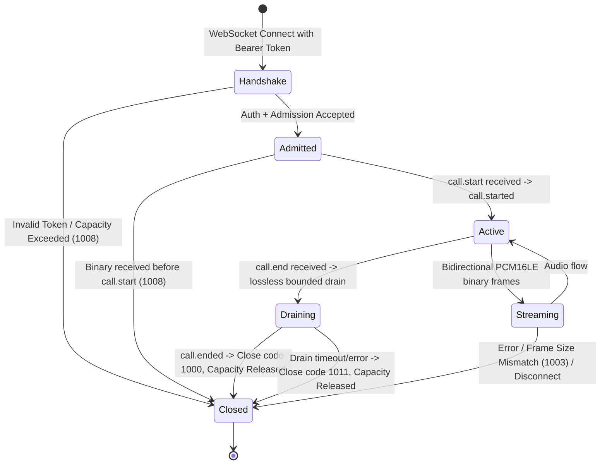

# Synthetic Binary WebSocket Media Protocol Specification (v1)

> **Status:** Test-only synthetic wire specification  
> **Milestone:** M4.2A  
> **Endpoint:** `/ws/synthetic-media/v1`  
> **Scope requirement:** `voice.stream`  
> **Ingress configuration:** Explicit opt-in via `enable_synthetic_media=True` (disabled by default)

## 1. Overview and Invariants

This specification defines the experimental synthetic binary media WebSocket contract for Kaiwen Gateway. It allows local development, end-to-end integration tests, and soak runners to stream raw audio frames through the Gateway's `VoiceBridgeSession` over a real network socket.

### Invariants:
1. **Isolated test endpoint:** Operates exclusively on `/ws/synthetic-media/v1`. The existing text-only `/ws/synthetic/v1` endpoint is preserved unchanged and continues to reject all binary frames.
2. **Explicit opt-in:** Disabled by default. Enabled only when `enable_synthetic_media=True` is explicitly supplied to the application factory.
3. **No production claims:** Strictly intended for loopback testing and synthetic benchmarking. Does not claim Verimor, Twilio, or SIP compatibility.
4. **Native binary transport:** Audio frames are transmitted as native WebSocket binary messages. No JSON, Base64, or string conversions are performed on raw media bytes.
5. **Strict PCM16LE format:** Standard 16 kHz mono 16-bit linear PCM with 20 ms frames (exactly 640 bytes per frame). Any frame deviating from 640 bytes is rejected fail-closed.
6. **Demultiplexed single read-loop:** Control events (JSON text) and media frames (binary) share a single connection managed by a unified ingress read-loop.
7. **Serialized outbound transport:** Text control responses and binary media frames are synchronized under an internal send lock to prevent interleaved ASGI writes.
8. **Pre-allocation admission:** Authentication, HMAC signature verification, token replay protection, scope checks, and Core connection admission must succeed before any media buffer or AI session is allocated.
9. **Loopback boundary:** Loopback isolation is enforced at the network socket bind layer (binding Uvicorn exclusively to `127.0.0.1`). The application does not rely on untrusted client headers (such as `Host` or `X-Forwarded-For`) to infer loopback residency.

---

## 2. Audio Media Profile

| Attribute | Value | Invariant |
| --- | --- | --- |
| **Format** | `pcm16le` | Raw 16-bit signed linear PCM, little-endian |
| **Channels** | 1 | Mono channel |
| **Sample Rate** | 16,000 Hz | Fixed sample rate |
| **Frame Duration** | 20 ms | 0.020 seconds per frame |
| **Samples per Frame** | 320 samples | 16,000 * 0.020 |
| **Bytes per Frame** | **640 bytes** | 320 samples * 2 bytes/sample |
| **Framing** | WebSocket Binary | Direct binary payload |

Any binary WebSocket frame with `len(payload) != 640` is rejected with close code `1003` (`WS_1003_UNSUPPORTED_DATA`).
Default bounded queue capacity is 8 frames (160 ms of audio at 20 ms/frame) across inbound adapter, Fake AI echo port, and bridge session queues.

---

## 3. Control Protocol Framing (Text Frames)

Control messages are exchanged as UTF-8 encoded JSON text frames.

### 3.1 Handshake & Authentication

The client initiates a standard WebSocket handshake with an HTTP `Authorization` header:

```http
GET /ws/synthetic-media/v1 HTTP/1.1
Host: 127.0.0.1:8000
Upgrade: websocket
Connection: Upgrade
Authorization: Bearer <HMAC_TOKEN>
```

The bearer token must satisfy:
- Valid HMAC-SHA256 signature signed with the provider secret.
- Valid timestamp within token tolerance (default 300s) and unexpired.
- Unique nonce (replay protection).
- Scope `voice.stream` included in `allowed_scopes`.

### 3.2 Server Greeting (`session.ready`)

Immediately upon completing admission and handshake accept, the server sends:

```json
{
  "event": "session.ready",
  "protocol_version": "v1",
  "connection_id": "conn_syn_1234567890abcdef",
  "tenant_id": "tenant_sample",
  "call_id": "call_sample",
  "allowed_scopes": ["voice.stream"]
}
```

### 3.3 Call Activation (`call.start` / `call.started`)

Before sending binary audio frames, the client must activate the call session:

**Client -> Server:**
```json
{
  "event": "call.start",
  "call_id": "call_sample"
}
```

The `call_id` in the payload must match the verified token `call_id`. Mismatches cause immediate connection termination.

**Server -> Client:**
```json
{
  "event": "call.started",
  "call_id": "call_sample"
}
```

Upon receiving `call.started`, the media leg is active and binary frames may be transmitted.

### 3.4 Ping / Pong

Clients may send periodic keep-alive pings:

**Client -> Server:**
```json
{
  "event": "session.ping",
  "seq": 1
}
```

**Server -> Client:**
```json
{
  "event": "session.pong",
  "seq": 1
}
```

### 3.5 Turn Interruption (`call.interrupt` / `call.interrupted`)

Clients issue turn interruption to cancel current generation (barge-in):

**Client -> Server:**
```json
{
  "event": "call.interrupt",
  "call_id": "call_sample",
  "turn_id": 1,
  "request_id": "optional-client-req-id"
}
```

- `call_id` (string, required): Must match verified connection context.
- `turn_id` (integer, required): Positive integer >= 1 indicating the active turn to interrupt. Cannot reference unreached future turns (`turn_id > current_turn_id` fails closed with close code `1008`).
- `request_id` (string, optional): ASCII alphanumeric/hyphen/underscore identifier up to 64 chars, echoed back in response.
- Unknown fields are strictly rejected fail-closed with close code `1007`.

**Server -> Client:**
```json
{
  "event": "call.interrupted",
  "call_id": "call_sample",
  "interrupted_turn_id": 1,
  "new_turn_id": 2,
  "locally_discarded_frames": 0,
  "stale_frames_suppressed": 0,
  "future_generation_cancelled": true,
  "transport_pending_cancelled": false,
  "provider_playback_cleared": false,
  "playback_confirmed": false,
  "request_id": "optional-client-req-id"
}
```

#### Turn & Ingress Ordering Invariants:
1. **Outbound Ordering Barrier:** An internal turn barrier ensures `call.interrupted` is transmitted over the WebSocket before any Turn T+1 binary media frames reach the client.
2. **Ingress Turn Tagging:** The single ingress reader stamps newly received binary audio frames with the current turn ID (`ingress_turn_id`), preventing stale frame suppression on Turn 2 audio.
3. **Stale Turn Idempotence:** If a client re-sends `call.interrupt` for an already-interrupted older turn (`turn_id < current_turn_id`), the server returns an idempotent `call.interrupted` with `locally_discarded_frames: 0` without advancing turn or closing the connection.
4. **Playback Acknowledgment Honesty:** `playback_confirmed` is strictly `false` because synthetic WebSocket transport cannot observe remote acoustic reception.

### 3.6 Graceful Termination (`call.end` / `call.ended`)

When speech streaming ends, the client issues a clean termination:

**Client -> Server:**
```json
{
  "event": "call.end",
  "call_id": "call_sample"
}
```

**Server -> Client:**
```json
{
  "event": "call.ended",
  "call_id": "call_sample"
}
```

The server halts new inbound audio ingestion, executes a bounded lossless drain of all in-flight frames through the Fake AI echo port to outbound telephony, transmits `call.ended` upon successful drain, and terminates the connection with clean close code `1000`. If drain fails or times out, `call.ended` is not transmitted and the server terminates with close code `1011`.

---

## 4. Lifecycle & State Machine



---

## 5. Error & Rejection Codes

| Condition | WebSocket Close Code | Reason Text |
| --- | --- | --- |
| Endpoint disabled | `1008` | `Synthetic media ingress not enabled` |
| Server draining / stopped | `1008` | `Server draining or unavailable` |
| Missing / invalid Authorization | `1008` | `Missing or invalid Authorization header` |
| Authentication / HMAC failed | `1008` | `Authentication or authorization failed` |
| Missing `voice.stream` scope | `1008` | `Missing required scope: voice.stream` |
| Admission limit exceeded | `1008` | `Admission rejected (capacity exceeded or draining)` |
| Call exclusivity collision | `1008` | `Call session already active` |
| Binary before `call.start` | `1008` | `Binary media received before call.start` |
| Invalid binary frame size | `1003` | `Invalid audio frame size: expected 640 bytes, got <len>` |
| Malformed JSON control | `1007` | `Malformed control message` |
| Unknown / invalid field in control | `1007` | `Malformed control message: Unknown field in call.interrupt: ...` |
| Missing / invalid `turn_id` in interrupt | `1007` | `Malformed control message: 'turn_id' must be a positive integer >= 1` |
| Call ID mismatch in control | `1008` | `Call ID in payload does not match connection context` |
| Interruption of future turn | `1008` | `Cannot interrupt future turn <turn_id> (current turn is <current>)` |
| `call.interrupt` when call inactive | `1008` | `call.interrupt received but call is not active` |
| `call.interrupt` on text-only endpoint | `1008` | `Unsupported event type` |
| Oversized control payload (>64 KiB) | `1009` | `Message size (...) exceeds maximum limit of 65536 bytes` |
| Upstream interruption failure | `1011` | `Upstream media interruption failed` |
| Session idle timeout | `1000` | `Session idle timeout` |
| Lifecycle init failure | `1011` | `Lifecycle initialization failed` |
| Drain failure or timeout | `1011` | `Call drain failed or timed out` |

